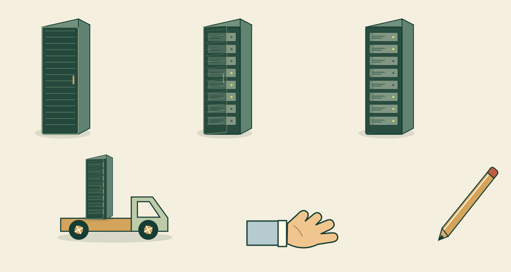

# 连贯动作道具

用于资金移交、机柜安装、物件接触和纸面签字的原创 SVG 道具。调用方用同一个帧时间驱动物件位置和动作状态。

文件为 `library/scenes/ActionObjects.tsx`。独立依赖 React，由外部 SVG 画布容纳。中文文字使用调用方加载的 Head 字体。默认尺寸为设计单位，按画布调整 scale。

| 组件 | 主要参数和动作 |
| --- | --- |
| Rack | x、y、scale、open（0 到 1）、lit、t。开门时前面板翻出并显露设备。 |
| Truck | x、y、scale、load、t。load 切换货物状态，轮子随 t 转动。轮速与位移应由调用方匹配。 |
| Hand | x、y、angle、scale、open。用于抓取前伸、张手递交和接物，切换姿势前后需检查接触点。 |
| Coin / Packet | x、y、rotate、scale，Packet 可指定 label。移动、加速、落定由场景编排。 |
| Chip / Tower / Building | 通用芯片、输电塔与数据中心楼体。设备细节与容量均为机制示意。 |
| Pen / Trace | Pen 用 x、y、angle 控制笔尖，Trace 按 t、start、duration 显露路径。笔尖与实际路径需由调用方一致驱动。 |

例如将同一枚筹码递交到机柜旁，可用 q(t,1,2.2) 得到平滑进度，lerp(a,b,p) 计算位置。settle(t) 提供带衰减的回弹，应只用于适合弹性收势的物件，不套给所有镜头。

这些道具保留动作状态，不替代分镜导演。先写物件怎样作用于另一物件、结果是什么，再安排运动。形状图案与示意数量不代表具体公司的设备规格。人物母版与真人照片继续使用各自资产来源。
