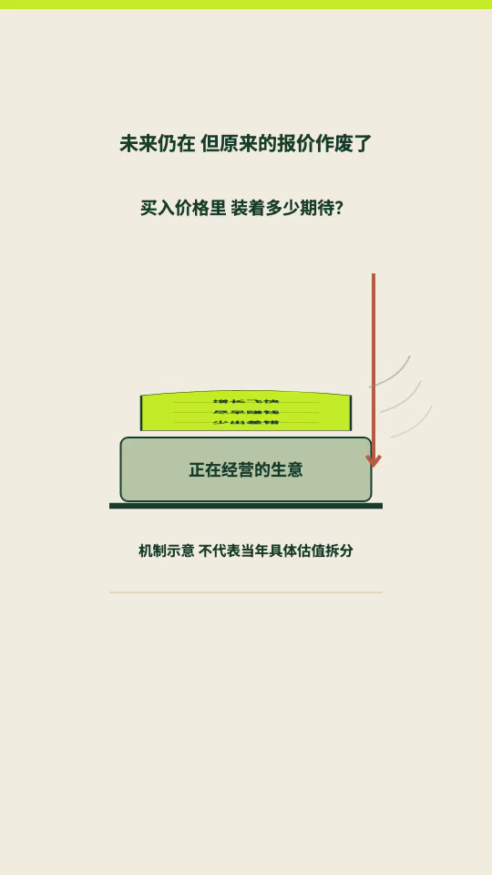

# 电商经营与预期动画部件

`library/scenes/CommerceObjects.tsx`，依赖theme.tsx，无照片、音频或网络依赖。原创SVG。已在2026-11-26亚马逊视频预览中检查对象前中末，附预期压缩场景渲染图。未将本期第三方照片与事实写入组件。

- Parcel：x/y/z/angle，纸箱立体外观，适合连续移动、出库与收货。
- Shop：x/y/z/label/open，店面与开关门状态；不是某家公司实际建筑或真实网站。
- Conveyor：x/y/w/t/speed，滚轮随时间转动；调用者安排物品位置，实现进入—移动—离开，不能单独以轮子空转填时长。
- StockStub：x/y/z/value/label/color/ticker，默认“股票”，凭证市值标签按语义设置；不冒充券商界面。
- ProfitGate：t/x/y/z，钱经过仓储物流人员费用的机制示意；不自动生成实际成本或利润，不能把三项图形当公司完整利润表。
- ExpectationRig：t/q/x/y/z，q从0到1压缩上方增长/盈利/执行预期，下方经营基础保持；定性图，不证明估值因素贡献或目标价。

竖版调用建议：主体在y470—1250，宽约x140—940；字幕独立。大幅缩放时重新检查标签和边缘。连续动作由口播时间驱动，不用墙钟随机数。

