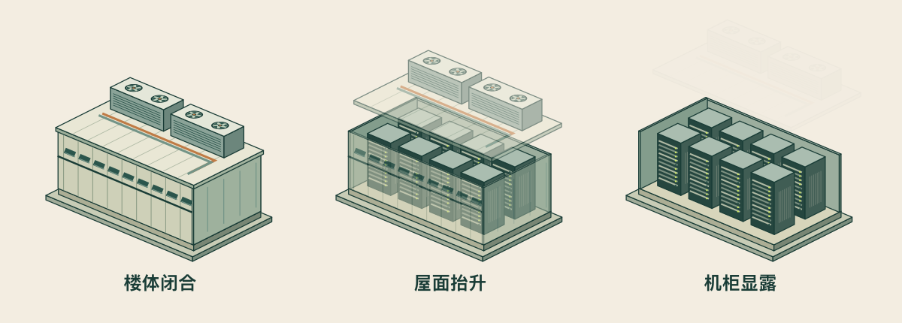

# 数据中心机房剖面

屋面抬起时，外墙逐渐隐去，两排机柜从楼体里显露出来。机柜、冷却机和变压器也可以拆开，用在单独的镜头里。



组件位于 `library/scenes/AtlasPlant.tsx`。它只绘制 SVG 元素，需要 React 的自动 JSX 运行时，由调用方提供画布、时间和文字。模型的布局和设备数量用于说明结构。讲解具体园区的面积、机柜数量或技术规格时，请使用该园区的资料。

| 组件 | 参数和用途 |
| --- | --- |
| `DataHall` | `open` 从 0 到 1，同步抬升屋面并显露机柜。传入当前秒数 `t` 驱动指示灯和冷却风扇。设 `powered={false}` 可熄灭服务器指示灯。 |
| `ServerRack` | `x`、`y` 为地面坐标，`t` 控制灯光，`power={0}` 熄灯。 |
| `Chiller` | 通过 `x`、`y`、`z` 摆放双风机，`t` 驱动旋转。保持 `t` 不变可表现停机。 |
| `Transformer` | 通过 `x`、`y` 摆放配电变压器。 |
| `IsoBlock` 和 `project` | 前者用 `w`、`l`、`h` 创建实体，后者将 `[x, y, z]` 投射到画布。用于让新增道具、管线端点与原有透视一致。 |

下面的例子在两秒内打开厂房。1080×1920 画布中，屋面的运动范围与下方字幕分开。给园区添加标注时，同时检查屋顶抬至最高和图形缩放后的边界。

```tsx
import {DataHall} from './library/scenes/AtlasPlant';

function HallShot({seconds}: {seconds: number}) {
  const progress = Math.max(0, Math.min(1, seconds / 2));
  const open = progress * progress * (3 - 2 * progress);
  return (
    <svg viewBox="0 0 1080 1920">
      <g transform="translate(435 876) scale(1.42)">
        <DataHall t={seconds} open={open} />
      </g>
    </svg>
  );
}
```
