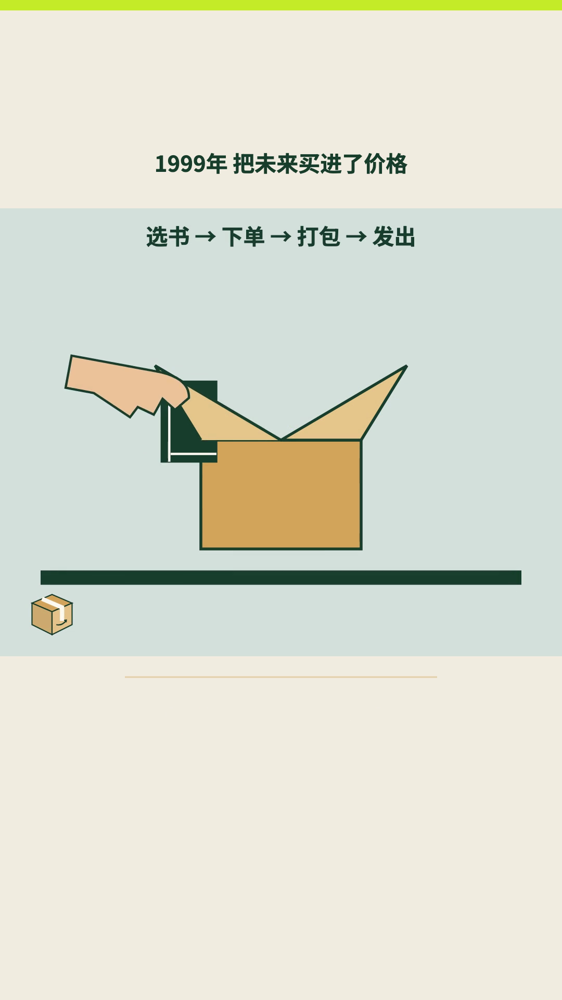

# 叙事道具与事件动作

library/scenes/NarrativeProps.tsx，原创SVG，依赖theme和CommerceObjects中的Parcel。

Book：可设标题颜色的书籍。Packing(t,x,y,z)：手将书放入箱中、合箱贴带、出库，t为0—6秒；重复时代表另一笔订单，不作为长时间填充。
Computer(t)：旧式电脑、图书、选购按钮和鼠标点击，情景示意，不能冒充真实网站截图。
Receipt：可设金额、标签、股票代码和角度的纸质凭证，不是券商界面；默认金额空占位，不含具体公司股价。
Warehouse：调用者传时期、金额和阶段，箱子数量不表示收入比例。Home：家庭沙发、窗外昼夜与季节，用于等待与生活情境；不是实拍。

已在2026-11-27亚马逊剧情版中检查多个状态。日期、金额和结论由每片核实后传入。道具应参与当前事件，而非每期固定重放打包或补货流程。纸箱退出和主体运动需避开字幕，手形是SVG动作，不是完整人物骨骼。

凭证默认局部坐标为0 由外层或显式x/y定位 避免嵌套平移叠加导致出画
