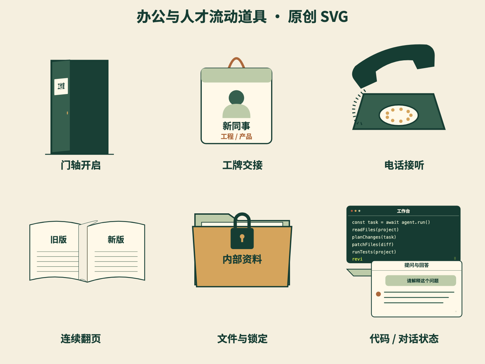

# 办公与人才流动道具

用于公司历史 人员流动 服务边界与产品体验故事的原创 SVG 组件 位于 `library/scenes/OfficeStoryProps.tsx` 依赖同目录 `ActionObjects.tsx` 的配色 文字和缓动函数 调用方加载 Head 字体并提供 SVG 画布

| 组件 | 参数与行为 |
| --- | --- |
| OfficeDoor | x y label open color small open为0到1 绕左门轴缩放及倾斜 打开后显露门内深色区域 |
| Badge | x y label sub color rotate scale 移动路径由外部帧时间控制 匿名工牌图案不是真人员肖像 |
| Phone | x y ring raised scale 振铃微动与听筒抬起 raised为0到1 不是手机组件 |
| Book | x y left right turn turn为0到1 中间页沿书脊连续翻转 两页标题独立 |
| Folder | x y label locked open scale 文件夹封面前移与锁定标记 不表示具体合同内容 |
| Terminal | x y w h t progress label problem 按progress显露代码 problem标红测试步骤 示意代码不代表真实产品内部实现 |
| ChatWindow | x y w t progress label 同一提问与逐行回答的示意 不伪造某公司的真实回答 |
| Desk | y wide 桌面与桌腿 角色和物件另行定位 |

所有坐标为设计单位 画布与字幕区由调用方检查 不自动替代分镜

例如 `OfficeDoor x={250} y={850} label="工作室" open={q(t,1,2.2)}` 让门先开启 再用同一段时间的Badge路径进入 避免人先穿过关门

本期做了编译 原创道具预览与场景检查 修正翻页路径数字坐标缺少空格造成的SVG解析警告 这些检查不代表正常速度完整听看或全自动验证动作质量

限制 扁平示意 电话线为简化路径 门不是完整三维实体 书页切换标题需在动作遮挡时由场景编排 不把历史事实写进通用默认值 第三方照片和本期语音成片均不入库
