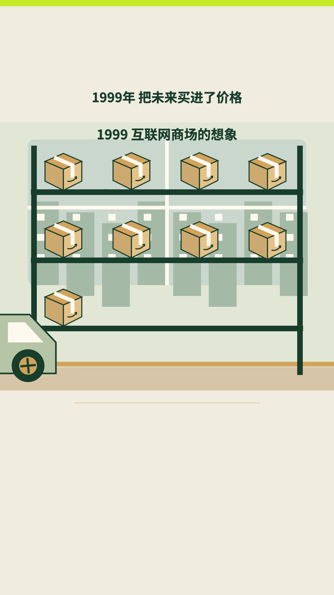

# 故事场景部件

library/scenes/StoryEnvironment.tsx；原创SVG，依赖theme和CommerceObjects中的Parcel。

StoryRoom(night)：城市窗景与室内地面，适合主持人情境，不内含账号字幕。
StockShelf(t,n)：仓库货架与逐箱补货，n为0—12箱，物件数不自动代表公司订单量或营收。
DeliveryTruck(x,y,t,label)：行驶车轮，位置由调用者控制；不是实际公司运输车辆照片。

三个组件均不含历史公司数据或外部照片。新增画面应按口播设计入库、补货、装车、发出和支出动作，不能只加背景让旧卡片移动。大场景顶部从y395开始，字幕保持独立；使用不同尺度前重查人物与标签避让。

